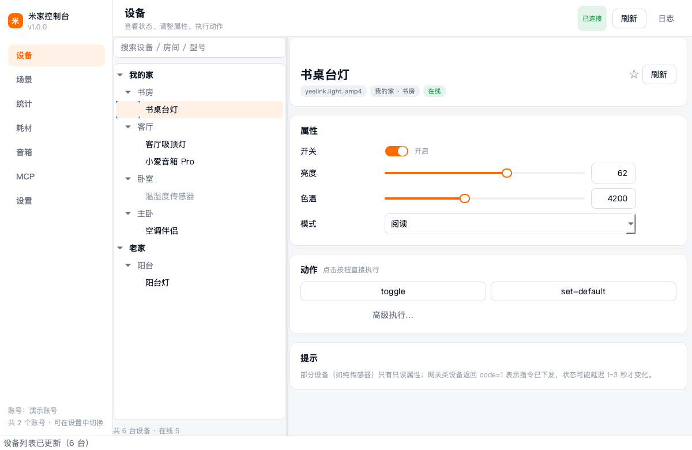
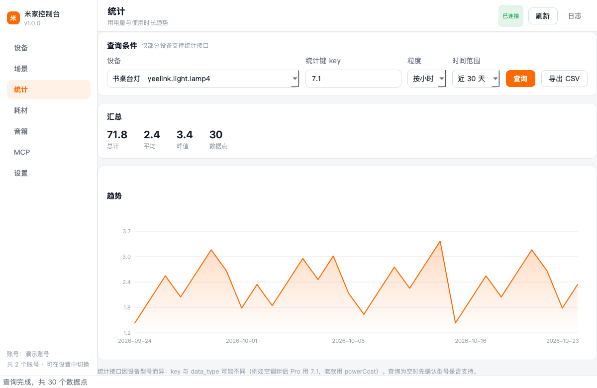
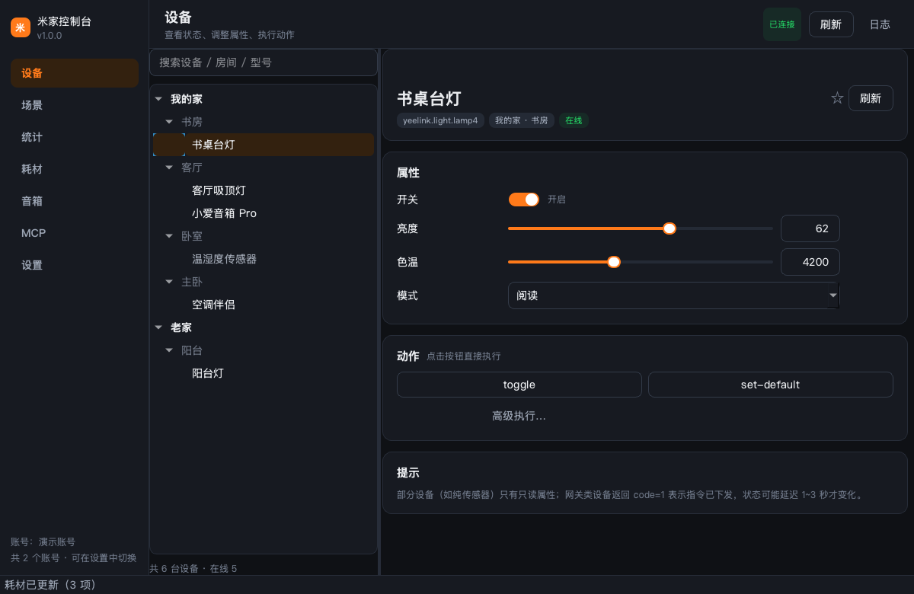

# 米家控制台 · MijiaConsole

基于 [mijiaAPI](https://github.com/Do1e/mijia-api) 的 **Windows 桌面客户端**：扫码登录后，用图形界面查看和控制米家设备，不再需要记 `siid / piid`，也不必开终端。



<table>
<tr>
<td></td>
<td></td>
</tr>
</table>

> 非官方客户端，与小米公司无关联。接口为逆向实现，可能随官方变更失效。

---

## 功能

| 模块 | 能力 |
|---|---|
| 登录 | 窗口内直接显示二维码（不用盯终端）；Token 自动续期；多账号独立凭证、一键切换 |
| 设备 | 家庭 / 房间树、搜索、收藏；按规格自动生成控件：开关、滑块、下拉枚举、数值输入；只读传感器单独展示 |
| 动作 | 一键执行设备动作；需要参数的动作提供 JSON 高级入口 |
| 场景 | 手动场景卡片，一键运行 |
| 统计 | 用电量 / 时长趋势折线图（近 7–180 天），汇总与 CSV 导出 |
| 耗材 | 滤芯、刷头、电池等剩余量，带进度条 |
| 音箱 | 让小爱执行自然语言指令，或朗读指定文本 |
| MCP | 生成 Claude Desktop / Cursor 可直接粘贴的配置，支持一键复制 |
| 其他 | 浅色 / 深色主题、系统托盘与开机自启、内置日志面板、单实例运行、**演示模式**（无账号也能预览界面） |

## 运行环境

- Windows 10 1809 及以上 / Windows 11（开发与构建在 Windows 上进行）
- 源码运行需 Python 3.10 – 3.13
- 打包后的 exe **不需要用户安装 Python**（PyInstaller 与 Nuitka 都会把运行时一起打包）

## 本地运行

```bash
python -m venv .venv
.venv\Scripts\activate

pip install -r requirements.txt
python run.py            # 正常启动
python run.py --demo     # 演示模式：假数据，不联网、不需要账号
```

首次启动会引导扫码登录；如果你之前用过 mijiaAPI 命令行，程序会自动把 `~/.config/mijia-api/auth.json` 导入为「默认账号」。

## 打包成 exe

### 方式一：PyInstaller（默认，快）

```bat
build\build.bat
```

产物：`dist\MijiaConsole\MijiaConsole.exe`（整个 `MijiaConsole` 目录即绿色版）。

要做安装包，装好 [Inno Setup](https://jrsoftware.org/isinfo.php) 后：

```bat
"%ProgramFiles(x86)%\Inno Setup 6\ISCC.exe" build\installer.iss
```

产物：`dist\MijiaConsole-Setup-1.0.1-x64.exe`。

### 方式二：Nuitka（原生编译，发布用）

```bat
pip install nuitka ordered-set zstandard
build\build_nuitka.bat
```

产物：`dist-nuitka\run.dist\MijiaConsole.exe`。Nuitka 把 Python 翻译成 C 再用 MSVC/MinGW 编译，反编译难度更高，启动略快，但构建时间从分钟级变成十几到几十分钟，且**必须有 C 编译器**（安装 Visual Studio Build Tools，或加 `--mingw64`）。

### 方式三：在 GitHub 上构建（本机不装 Windows 工具链）

`mijia-api` 与打包配置都在仓库里，推上去即可用 Actions 出包：

1. 推到 GitHub；
2. Actions → **build-windows** → Run workflow，选择引擎：
   - `pyinstaller`：便携 zip + Inno 安装包，约 5–8 分钟；
   - `nuitka`：原生编译包，约 20–40 分钟；
   - `both`：两条都跑。
3. 跑完后在该次运行的 **Artifacts** 下载 `MijiaConsole-portable` / `MijiaConsole-setup` / `MijiaConsole-nuitka`。

打 tag 会自动创建 Release 并附上产物：

```bash
git tag v1.0.0 && git push origin v1.0.0
```

> 说明：GitHub Actions 的 `windows-latest` 就是一台 Windows Server，PyInstaller / Nuitka 都能正常跑；但两者都**不能交叉编译**，所以必须在 Windows（真机或 CI）上构建。公开仓库的 Actions 免费额度不限。

## 数据与配置

| 内容 | 位置（Windows） |
|---|---|
| 设置 | `%APPDATA%\MijiaDesktop\settings.json` |
| 账号凭证 | `%APPDATA%\MijiaDesktop\accounts\*.json` |
| 设备规格缓存 | 与凭证同目录的 `urn_miot-spec-v2_*.json` |
| 日志 | `%APPDATA%\MijiaDesktop\logs\app.log`（轮转，保留 3 份） |

凭证是明文 JSON，内含登录 Token。请不要提交到仓库、不要发给他人；换机器时建议重新扫码。

## 常见问题

**二维码扫不出来？** 把窗口拉大一点；二维码是 262px 渲染的，缩放显示或极小窗口会影响识别。也可在浏览器打开 MCP 页里给出的凭证路径确认登录状态。

**设备列表为空？** 确认米家 App 里该账号下确有设备；共享设备也会列出（家庭名显示「共享设备」）。

**某台设备看不到属性？** 该设备缺少 `spec_type`，或从 `miot-spec.org` 拉取规格失败（首次需要联网）。鼠标悬停属性行可看到原始属性名与取值范围。

**统计查询为空？** 统计接口按设备型号而异：`key` 与 `data_type` 不是通用的，例如空调伴侣 Pro 用 `7.1`，老款用 `powerCost`，部分设备根本不支持。详见上游 [issue #46](https://github.com/Do1e/mijia-api/issues/46)。

**设置成功但状态没变？** 米家网关返回 `code=1` 表示「指令已接收、结果未知」，界面会提示「指令已发送（设备异步执行）」，稍等 1–3 秒再刷新。

**杀毒软件报毒？** PyInstaller/Nuitka 产物被误报很常见，加白名单即可；正式分发建议做代码签名。

**公司网络连不上？** 程序走系统代理（`HTTPS_PROXY`）；若 MITM 证书不被信任，需要设置 `REQUESTS_CA_BUNDLE`。

## 项目结构

```
mijia-desktop/
├── app/
│   ├── main.py              # 入口：单实例、主题、日志、QApplication
│   ├── demo.py              # 演示数据（无账号预览 / 无头截图）
│   ├── core/                # 纯逻辑层，不依赖 Qt
│   │   ├── service.py       # 账号、登录、设备、场景、统计、耗材、音箱
│   │   ├── config.py        # 设置读写（原子写、失败降级）
│   │   ├── tasks.py         # 线程池 + 信号回调
│   │   ├── logbus.py        # 日志桥接（文件 / 控制台 / 界面）
│   │   └── autostart.py     # 注册表开机自启
│   └── ui/
│       ├── main_window.py   # 侧边导航、托盘、日志抽屉
│       ├── login_dialog.py  # 扫码登录
│       ├── theme.py         # 两套 QSS
│       ├── widgets.py       # 开关、属性行、折线图
│       └── pages/           # 设备 / 场景 / 统计 / 耗材 / 音箱 / MCP / 设置
├── build/                   # PyInstaller spec、Inno Setup、Nuitka 脚本
├── .github/workflows/       # Windows 构建流水线
├── tests/shots.py           # 无头渲染截图（布局回归）
└── tools/make_icon.py       # 生成 app.ico / app.png
```

## 开发

```bash
ruff check .                 # 静态检查（行宽 110，E/F/W/I/C）
python tests/shots.py        # 无头渲染 8 张截图到 .shots/
```

`tests/shots.py` 会隔离 `HOME`，用演示数据跑一遍所有页面；改完布局先跑它，比手点快。

## 许可

本项目以 **GPL-3.0-or-later** 发布——它链接了 GPL-3.0 的 `mijiaAPI`，因此分发（包括打包后的 exe）时必须一并提供源代码与同一许可证。详见 [LICENSE](LICENSE)。

免责声明：仅供学习交流，不得用于商业用途；使用本项目产生的任何后果由使用者自行承担。
